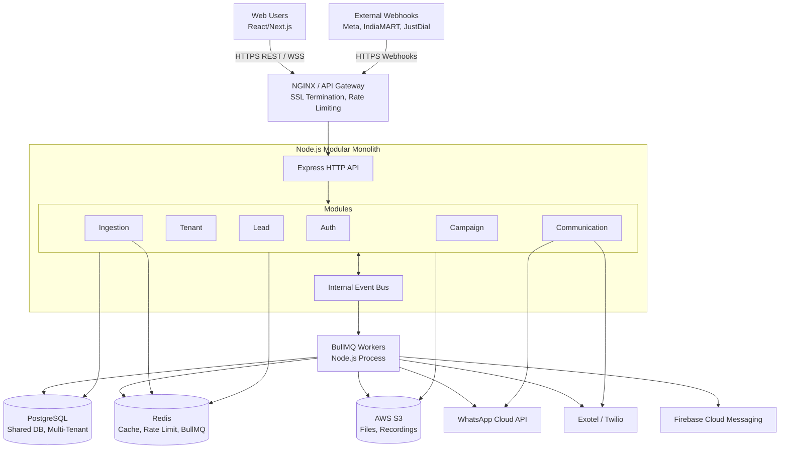
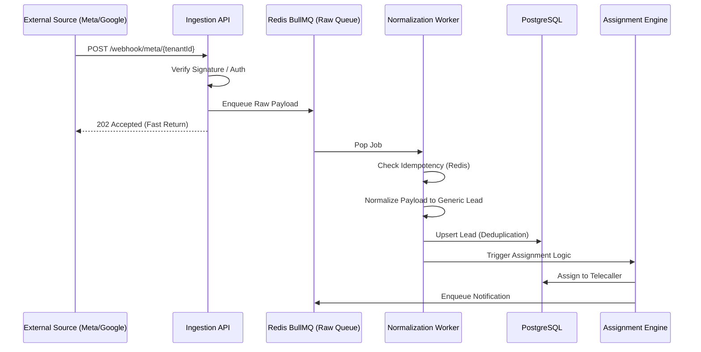

# GlovaCRM — High-Level Design (HLD)

**Version:** v1.0  
**Stage:** Step 3 - High-Level Design  
**Source:** Project Requirements & Architecture Vision  
**Purpose:** Define the high-level system architecture, module boundaries, data flow, external integrations, background workflows, deployment view, and major engineering decisions before DB schema, LLD, and API design.

---

## 1. Executive Summary

GlovaCRM is a Multi-Tenant SaaS Customer Relationship Management (CRM) platform designed specifically for the Indian market. Drawing inspiration from platforms like TeleCRM, GlovaCRM differentiates itself through advanced customization capabilities, robust multi-tenant isolation, and deep integrations with India-specific lead generation and communication portals.

The platform serves organizations (tenants) that require efficient lead management, automated workflows, and omni-channel communication. It enables businesses to capture leads automatically from multiple sources, assign them intelligently to sales representatives (telecallers), track follow-ups, and run automated communication campaigns via WhatsApp and traditional telephony.

### MVP Scope (IN SCOPE)
1. **Multi-Tenancy:** Complete logical isolation of organizational data within a shared database architecture.
2. **Lead Ingestion:** Automated capture from Meta Graph API, Google Ads API, WhatsApp Business Cloud API, and Indian portals (IndiaMART, JustDial, 99acres, MagicBricks, Sulekha) via Webhooks and Pull mechanisms.
3. **Communication:** Telephony abstraction layer supporting Twilio, Exotel, and direct SIM-based dialing. Full WhatsApp Cloud API integration.
4. **Campaigns:** Manual and automated outreach campaigns based on lead status changes or scheduled triggers.
5. **Role-Based Access Control (RBAC):** Hierarchical access (Super Admin, Tenant Admin, Team Manager, Telecaller).
6. **Analytics:** Leaderboards, calling reports, lead conversion funnels.
7. **Real-time Notifications:** In-app and push notifications for lead assignments and reminders.

### OUT OF SCOPE (For MVP)
1. Dedicated physical databases per tenant (Silo architecture).
2. AI-driven sentiment analysis on call recordings.
3. Native mobile applications (iOS/Android) - MVP will rely on Next.js PWA/Responsive web.
4. Advanced custom reporting builder (Looker-style).

---

## 2. HLD Goals

This document is intended to guide the engineering team at a system level. It provides the architectural blueprint required to ensure all team members understand the system's structural constraints and design patterns.

By reading this document, a senior developer should understand:
1. The structural choice of a Modular Monolith and why it was selected.
2. How the Next.js Frontend, Node.js Backend, PostgreSQL, and background workers interact.
3. How multi-tenancy is strictly enforced across the application and database layers.
4. The exact ingestion pipeline for handling high-volume webhooks.
5. The abstraction strategy for telephony and WhatsApp providers.
6. The background job architecture for asynchronous processing.
7. Security, deployment, and scalability strategies.

---

## 3. Core Architecture Decision

### 3.1 Recommended Architecture: Modular Monolith

GlovaCRM will be built as a **Modular Monolith** using Node.js and Express.js with TypeScript. The frontend will be a Next.js application.

#### Technology Stack

| Layer | Technology | Justification |
|---|---|---|
| **Backend API** | Node.js + Express + TypeScript | High developer velocity, vast ecosystem, excellent asynchronous I/O handling for webhook ingestion. |
| **Frontend** | Next.js + React + TypeScript | SSR for initial load, excellent state management, shared types with backend. |
| **Database** | PostgreSQL | ACID compliance, JSONB support for custom fields, excellent relational integrity for multi-tenancy. |
| **ORM** | Prisma | Type-safe database access, excellent schema migration management. |
| **Cache / KV** | Redis | Session storage, rate limiting, pub/sub for real-time events, caching frequent queries. |
| **Message Queue** | BullMQ (over Redis) | Robust job queueing for lead ingestion, campaigns, and scheduled tasks. |
| **File Storage** | AWS S3 | Storing call recordings, invoice PDFs, user avatars, and exported reports. |
| **Authentication** | JWT + Refresh Tokens | Stateless API authentication with secure rotation. |
| **Telephony** | Abstracted (Twilio/Exotel) | Pluggable interface to swap providers without changing core logic. |
| **WhatsApp** | Meta Cloud API | Official integration for rich messaging. |

### 3.2 Why Modular Monolith for MVP?

While Microservices offer independent scalability, a Modular Monolith is the optimal choice for the GlovaCRM MVP for several reasons:

1. **Operational Simplicity:** Deploying a single backend artifact reduces DevOps complexity during the rapid iteration phase.
2. **Refactoring Ease:** Moving logic between modules is a simple function call rather than a complex distributed transaction or network call.
3. **Data Integrity:** A single database makes enforcing relational constraints and multi-tenancy rules significantly easier via Foreign Keys and Row-Level Security (RLS).
4. **Performance:** In-process communication is orders of magnitude faster than network calls between services.
5. **Future-Proofing:** By strictly enforcing module boundaries (no cross-module database joins bypassing APIs), the monolith can be easily fractured into microservices when organizational scale demands it.

### 3.3 Important Boundary Rules

To ensure the monolith remains modular, the following rules MUST be strictly enforced:

1. **No Cross-Module DB Access:** Module A cannot directly query the database tables owned by Module B. It must call Module B's exposed Service layer.
2. **Domain Events:** Inter-module communication that is not strictly synchronous should happen via an internal Event Bus or Redis Pub/Sub.
3. **Single Responsibility:** Each module has its own route definitions, controllers, services, and distinct Prisma schema models (even if in a single schema.prisma file, they should be logically grouped).
4. **Dependency Injection:** Services should be injected to allow easy mocking during tests and strict contract enforcement.

---

## 4. System Architecture Diagram



### Diagram Explanation
1. **Traffic Entry:** All external traffic (users and webhooks) hits a load balancer which handles rate limiting and SSL termination before routing to the Node.js API.
2. **API Layer:** Express handles HTTP routing, authentication middleware, and tenant injection.
3. **Modules:** Business logic is encapsulated in distinct modules that communicate via an internal event bus or direct service calls.
4. **Data Layer:** PostgreSQL acts as the primary datastore, Redis handles ephemeral data and queues, and S3 handles blobs.
5. **Workers:** BullMQ workers operate in a separate Node.js process (or same process for local dev) to drain queues populated by the API (e.g., async lead processing, bulk SMS).

---

## 5. Module Map

The application is logically divided into the following bounded contexts:

### 5.1 Platform Module
- **Responsibilities:** Super Admin capabilities, managing global settings, managing tenants.
- **Key Entities:** Tenant, Subscription, GlobalConfig.
- **Operations:** Create tenant, suspend tenant, upgrade plan.

### 5.2 Auth Module
- **Responsibilities:** User authentication, JWT issuance, refresh token rotation, password resets, role-based access control evaluation.
- **Key Entities:** User, Role, Permission, Session, Invitation.
- **Operations:** Login, logout, refresh, send invite, verify invite.

### 5.3 Tenant Module
- **Responsibilities:** Organization-level configurations, team structure, custom field definitions for leads, pipeline stages.
- **Key Entities:** OrganizationSettings, Team, Pipeline, Stage, CustomField.
- **Operations:** CRUD teams, manage pipeline stages, define custom fields.

### 5.4 Lead Module
- **Responsibilities:** Core CRM entity management. Lead lifecycle, assignment tracking, interaction history, scoring.
- **Key Entities:** Lead, LeadHistory, Note, Task, LeadScore.
- **Operations:** Create lead, update status, reassign, add note, log call.

### 5.5 Ingestion Module
- **Responsibilities:** Safely receiving, validating, normalizing, and enqueuing inbound leads from various webhooks.
- **Key Entities:** WebhookConfig, IngestionLog, SourceMapper.
- **Operations:** Receive webhook, verify signature, map payload to generic lead format, enqueue for processing.

### 5.6 Communication Module
- **Responsibilities:** Handling outbound and inbound calls, SMS, and WhatsApp messages. Abstracting provider specifics.
- **Key Entities:** CallLog, MessageLog, Template.
- **Operations:** Click-to-dial, send WhatsApp, handle incoming SMS webhook, sync call recording.

### 5.7 Campaign Module
- **Responsibilities:** Bulk outreach logic. Manual blasts and automated drip campaigns based on triggers.
- **Key Entities:** Campaign, Sequence, CampaignExecution.
- **Operations:** Create campaign, start sequence, pause campaign, evaluate trigger.

### 5.8 Analytics Module
- **Responsibilities:** Aggregating data for reports, dashboards, and telecaller leaderboards.
- **Key Entities:** Pre-aggregated materialized views or summary tables.
- **Operations:** Get telecaller performance, get pipeline funnel, generate export.

### 5.9 Notification Module
- **Responsibilities:** Delivering alerts to users (In-app, Push, Email).
- **Key Entities:** Notification, Preference.
- **Operations:** Dispatch notification, mark as read.

### 5.10 Audit Module
- **Responsibilities:** Tracking sensitive actions (exports, bulk deletes, permission changes) for compliance.
- **Key Entities:** AuditLog.
- **Operations:** Log action, query logs.

---

## 6. Multi-Tenancy Design

GlovaCRM uses a **Shared Database, Shared Schema** multi-tenancy model. This provides the best balance of cost-efficiency and maintenance simplicity for the MVP.

### 6.1 Database Enforcement
Every tenant-specific table in the database MUST include a `tenant_id` column.

```sql
CREATE TABLE leads (
    id UUID PRIMARY KEY,
    tenant_id UUID NOT NULL REFERENCES tenants(id),
    name VARCHAR(255) NOT NULL,
    phone VARCHAR(20) NOT NULL,
    -- other fields
);
CREATE INDEX idx_leads_tenant_id ON leads(tenant_id);
```

### 6.2 Application Level Enforcement (Middleware)
We will enforce tenant isolation at the application middleware level. 

1. **Authentication:** The JWT contains the user's `tenant_id`.
2. **Context Injection:** Express middleware extracts the `tenant_id` from the JWT and attaches it to the request object (`req.tenantId`).
3. **Service Layer:** ALL service methods that interact with the DB must require `tenantId` as an argument.

```typescript
// BAD
async getLead(leadId: string) {
    return prisma.lead.findUnique({ where: { id: leadId } });
}

// GOOD
async getLead(tenantId: string, leadId: string) {
    return prisma.lead.findUnique({ 
        where: { id_tenantId: { id: leadId, tenantId: tenantId } } 
    });
}
```

### 6.3 Prisma Extension (Client Level Enforcement)
To prevent accidental data leakage due to developer error, we will use Prisma Client Extensions to automatically inject the `tenant_id` into all queries.

```typescript
// Prisma Client Extension concept
const tenantPrisma = (tenantId: string) => {
  return prisma.$extends({
    query: {
      $allModels: {
        async $allOperations({ model, operation, args, query }) {
          // Exclude global tables
          if (!['Tenant', 'User', 'GlobalConfig'].includes(model)) {
             // Automatically inject tenantId into where clauses
             args.where = { ...args.where, tenantId };
             if (operation === 'create' || operation === 'createMany') {
                 args.data = { ...args.data, tenantId };
             }
          }
          return query(args)
        },
      },
    },
  })
}
```

### 6.4 Row-Level Security (PostgreSQL RLS)
As a defense-in-depth measure, PostgreSQL Row-Level Security will be enabled on all tenant tables. The API connection pool will set a local session variable (`glova.current_tenant_id`) before executing queries, ensuring the DB engine strictly filters data even if application logic fails.

---

## 7. Authentication & Authorization Flow

### 7.1 JWT + Refresh Token Flow
1. User authenticates with Email/Password.
2. Server validates credentials and returns:
   - `access_token` (JWT): Short-lived (15 minutes). Contains `userId`, `tenantId`, `role`.
   - `refresh_token` (Opaque String): Long-lived (7 days). Stored in HTTP-only, secure cookie. Stored hashed in the DB.
3. Client uses `access_token` for API requests (Bearer header).
4. When `access_token` expires (401 response), client calls `/auth/refresh` using the cookie.
5. Server validates `refresh_token`, rotates it, and returns a new `access_token`.
6. Logout revokes the refresh token in the DB and clears the cookie.

### 7.2 Role Hierarchy & RBAC
Roles are predefined (Static RBAC) for the MVP to reduce complexity.

1. **SUPER_ADMIN:** GlovaCRM employee. Manages tenants and global billing.
2. **TENANT_ADMIN:** Business Owner. Can configure integrations, pipelines, billing, and view all data within the tenant.
3. **TEAM_MANAGER:** Can view and reassign leads within their specific team. Can view reports for their team.
4. **TELECALLER:** Can only view and interact with leads explicitly assigned to them. Cannot export data.

### 7.3 Permission Matrix (Excerpt)

| Action | SUPER_ADMIN | TENANT_ADMIN | TEAM_MANAGER | TELECALLER |
|---|---|---|---|---|
| Create Tenant | Yes | No | No | No |
| Setup Webhooks | No | Yes | No | No |
| Export Leads | No | Yes | Yes (Team only) | No |
| Assign Leads | No | Yes | Yes (Team only) | No |
| Call Lead | No | Yes | Yes | Yes (Assigned only)|
| Delete Lead | No | Yes | No | No |

---

## 8. Lead Ingestion Architecture (DETAILED)

The ingestion pipeline must handle high throughput and unpredictable spikes from external ad platforms without dropping leads or impacting core API performance.

### 8.1 Ingestion Pipeline Diagram



### 8.2 Webhook Reception & Verification
Webhooks are received at source-specific endpoints (e.g., `/api/v1/webhooks/meta/:tenantId`). 
- **Verification:** The API instantly verifies the payload signature (e.g., SHA256 HMAC for Meta) using the tenant's configured secret.
- **Fast Response:** The API does NOT process the lead synchronously. It validates the signature, pushes the raw JSON payload to a Redis queue, and immediately returns a `200 OK` or `202 Accepted` to prevent the external provider from timing out and retrying.

### 8.3 Idempotency & Deduplication
- **Idempotency:** The worker checks a Redis key `lead:ingest:{source_lead_id}`. If it exists, the job is marked complete (duplicate webhook delivery).
- **Deduplication:** When inserting into PostgreSQL, the system uses custom rules defined by the tenant (e.g., deduplicate by `phone_number` OR `email`). 
- If a duplicate is found, the system updates the existing lead's `last_interaction_date` and appends a `LeadHistory` record indicating a repeat inquiry, rather than creating a duplicate row.

### 8.4 Normalization Layer
Different sources send different JSON structures. The Normalization Worker uses Strategy Pattern mappers:
- `MetaMapper`: Extracts data from Meta Lead Gen form payload.
- `IndiaMartMapper`: Extracts data from IndiaMART Push API XML/JSON.
- Converts to a standard internal `LeadPayload` interface.

### 8.5 Scoring & Assignment Dispatch
Once saved, the lead enters the Router:
1. **Scoring Engine:** Evaluates simple rules (e.g., if CustomField "Budget" > 10L, score +50).
2. **Round-Robin Assignment:** Checks active telecallers in the designated team and assigns the lead to the one with the least recent assignments, considering their working hours status.
3. **Notification:** Dispatches real-time WebSocket events and push notifications to the assigned telecaller.

---

## 9. Communication Architecture

### 9.1 Telephony Provider Abstraction
GlovaCRM must not be hardcoded to a single telephony provider. We will implement a `TelephonyService` interface.

```typescript
interface ITelephonyProvider {
    initiateClickToDial(agentNumber: string, customerNumber: string): Promise<CallResult>;
    getCallRecording(callId: string): Promise<string>;
    sendSMS(to: string, message: string): Promise<boolean>;
}
```
Concrete implementations (`TwilioAdapter`, `ExotelAdapter`) will be injected based on the tenant's configuration.

### 9.2 Click-To-Dial Flow
1. Telecaller clicks "Call" on the Web UI.
2. API calls `initiateClickToDial`.
3. The provider (e.g., Exotel) first calls the Telecaller's phone.
4. Once the Telecaller answers, the provider bridges the call to the Lead's phone.
5. The provider sends webhooks to GlovaCRM regarding call state changes (ringing, in-progress, completed).
6. GlovaCRM logs the call duration and links the recording URL to the `LeadHistory`.

### 9.3 WhatsApp Provider Abstraction
Similar to Telephony, WhatsApp will use the official Meta Cloud API.
- **Template Messaging:** Tenants must pre-register templates with Meta. GlovaCRM will sync template statuses.
- **Session Messaging:** When a lead replies, a 24-hour session window opens, allowing free-form text. GlovaCRM routes inbound messages via webhook to the assigned telecaller's chat interface.

### 9.4 SIM-Based Dialing Strategy
For micro-businesses avoiding cloud telephony costs, a SIM-based flow is supported:
1. Telecaller clicks "Call" on a mobile PWA.
2. Uses `tel:` URI scheme to open the native dialer.
3. Application presents a modal: "Did you speak with the lead?" to manually capture call disposition, as automated tracking is impossible here.

---

## 10. Real-time Features

### 10.1 WebSocket Architecture
Real-time updates are critical for a CRM to prevent telecallers from stepping on each other's toes and for instant lead engagement.

- **Technology:** `Socket.io` attached to the Node.js Express server.
- **Authentication:** WebSocket handshake requires the JWT access token.
- **Rooms:** Clients are subscribed to tenant-specific and user-specific rooms.
  - `tenant_{tenantId}_broadcast`: Global announcements.
  - `user_{userId}`: Personal notifications (New lead assigned, chat message received).
  - `lead_{leadId}`: Used to show "Telecaller A is currently viewing this lead" to prevent collision.

### 10.2 Internal Event Bus
To decouple modules, the application uses an internal `EventEmitter` (or Redis Pub/Sub if running multiple Node instances).
- **Example:** When `LeadModule` changes a status to "Won", it emits `LEAD_WON`.
- `CampaignModule` listens to `LEAD_WON` and stops any ongoing drip sequences for that lead.
- `AnalyticsModule` listens to `LEAD_WON` and increments the telecaller's closed-won counter in the cache.

---

## 11. Background Job Architecture

We use **BullMQ** backed by Redis for durable, distributed job processing.

### 11.1 Queue Definitions
1. `ingestion-queue`: High priority. Processes raw incoming webhooks.
2. `notification-queue`: Medium priority. Dispatches emails, SMS, and push notifications.
3. `campaign-queue`: Medium priority. Executes bulk WhatsApp/SMS blasts. Handles rate limiting and provider throttling.
4. `sync-queue`: Low priority. Background tasks like downloading and archiving call recordings from Exotel to S3, syncing WhatsApp templates from Meta.
5. `scheduled-tasks`: Recurring cron jobs (e.g., daily summary emails, end-of-day leaderboard calculations).

### 11.2 Worker Scaling Strategy
For the MVP, worker processes will run in the same container as the API (or as a separate container replicating the same codebase but executing `worker.ts` instead of `server.ts`).
As load increases, the worker containers can be scaled independently of the API containers. BullMQ safely handles concurrent workers pulling from the same queue using Redis locks.

---

## 12. File Storage Strategy

**AWS S3** (or compatible like Cloudflare R2 / DigitalOcean Spaces) will be the central blob storage.

### 12.1 Storage Buckets & Paths
A single bucket will be used, strictly partitioned by `tenant_id`:
`glovacrm-prod-bucket/tenants/{tenant_id}/{entity_type}/{file_name}`

Example: `glovacrm-prod-bucket/tenants/t-12345/recordings/call-8899.mp3`

### 12.2 Access Control
- Files in S3 are **Private**.
- When the UI needs to play a call recording or download an invoice, the API generates an **S3 Pre-signed URL** valid for 15 minutes and returns it to the client.
- This ensures that authorization (checking if the user belongs to the tenant and has permissions) is evaluated by the Node API before granting access to the file.

---

## 13. Caching Strategy

**Redis** will be utilized to reduce database load and improve response times.

### 13.1 Cache Topologies
1. **Session & Auth:** Storing revoked refresh tokens (denylist) and active session metadata.
2. **Tenant Configuration:** Global settings, active integrations, and custom field schemas are cached with a long TTL, invalidated via Event Bus when a Tenant Admin updates them.
3. **Rate Limiting:** IP and Tenant-based API rate limiting sliding windows.
4. **Leaderboards:** Daily telecaller rankings are calculated incrementally and stored in Redis Sorted Sets (`ZADD`) for sub-millisecond retrieval by the dashboard.

---

## 14. Security Considerations

### 14.1 OWASP Principles
- **Input Validation:** Zod schemas validate ALL incoming request bodies and query parameters before reaching the controller logic.
- **SQL Injection:** Prevented by using Prisma ORM parameterization.
- **XSS:** Next.js automatically escapes React variables. API ensures strict `Content-Type: application/json`.
- **CSRF:** API is stateless (Bearer tokens). Web application uses SameSite cookies for refresh tokens.

### 14.2 Multi-Tenant Data Leaks
Mitigated via three layers:
1. JWT Context Injection.
2. Prisma Client Extensions (automatic `where` clauses).
3. PostgreSQL Row-Level Security (RLS).

### 14.3 Credential Encryption
External API keys (e.g., Twilio Token, Meta App Secret) configured by tenants are encrypted at rest in the PostgreSQL database using AES-256-GCM. The encryption key is stored in environment variables (AWS KMS/HashiCorp Vault in production).

---

## 15. Deployment View

### 15.1 Containerization
The platform is fully Dockerized.
- `api-service`: Node.js Express server.
- `worker-service`: Node.js BullMQ worker (same image, different entrypoint).
- `frontend-app`: Next.js production build.

### 15.2 CI/CD Pipeline
Using GitHub Actions:
1. **PR Stage:** Lint (ESLint), Typecheck (tsc), Unit Tests (Jest), DB Schema validation.
2. **Merge to Main:** Build Docker images, push to AWS ECR / Docker Hub.
3. **Deploy Stage:** Trigger rolling update on target environment (AWS ECS or Kubernetes). Database migrations are run automatically via a pre-sync hook before new API pods serve traffic.

### 15.3 Environment Strategy
- **Development:** Local Docker Compose (Postgres, Redis, API, Frontend).
- **Staging:** Cloud replica of production for QA and User Acceptance Testing.
- **Production:** High Availability setup with read-replicas for Postgres, clustered Redis, and auto-scaling API nodes.

---

## 16. Scalability Path

As GlovaCRM grows, the architecture is designed to evolve without complete rewrites:

1. **Phase 1 (MVP):** Modular Monolith + Single Postgres DB + Single Redis.
2. **Phase 2 (Read Scaling):** Introduce Postgres Read Replicas. Direct complex analytics queries to the replica.
3. **Phase 3 (Vertical Partitioning):** Move high-volume data (like `CallLogs` and `AuditLogs`) to specialized databases (e.g., ClickHouse or Elasticsearch).
4. **Phase 4 (Microservices):** If organizational complexity demands it, extract specific modules (e.g., `IngestionModule` or `CommunicationModule`) into their own deployed services. The strict boundary rules established in the monolith phase make this extraction straightforward.

---

## 17. Monitoring & Observability

### 17.1 Logging
- **Application Logs:** Structured JSON logging using `Winston` or `Pino`. Logs include `traceId`, `tenantId`, and `userId` for easy filtering.
- **Aggregation:** Logs shipped to centralized logging (e.g., Datadog, ELK stack, or AWS CloudWatch) via standard stdout capture.

### 17.2 Metrics
- **Prometheus/Grafana:** Exposing `/metrics` endpoint on the API to track:
  - HTTP request duration percentiles (p95, p99).
  - Database connection pool utilization.
  - BullMQ queue lengths and processing latency.

### 17.3 Alerting
- High error rates (5xx responses > 1%).
- Queue backup (Ingestion queue age > 5 minutes).
- Database CPU/Memory > 80%.
Alerts will be routed to the engineering team via Slack/PagerDuty.

---
*End of Document*
